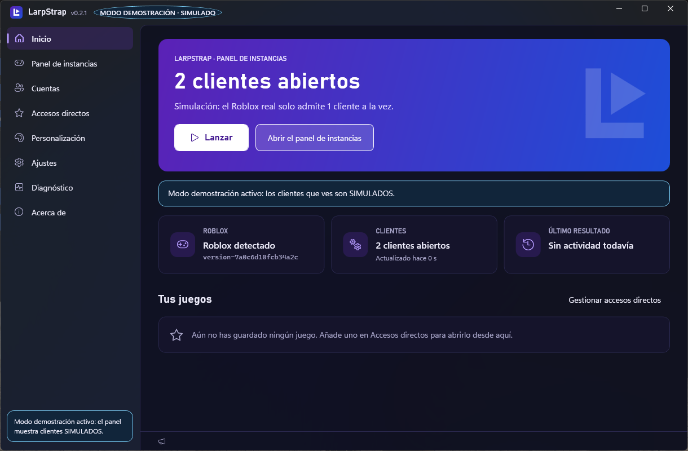
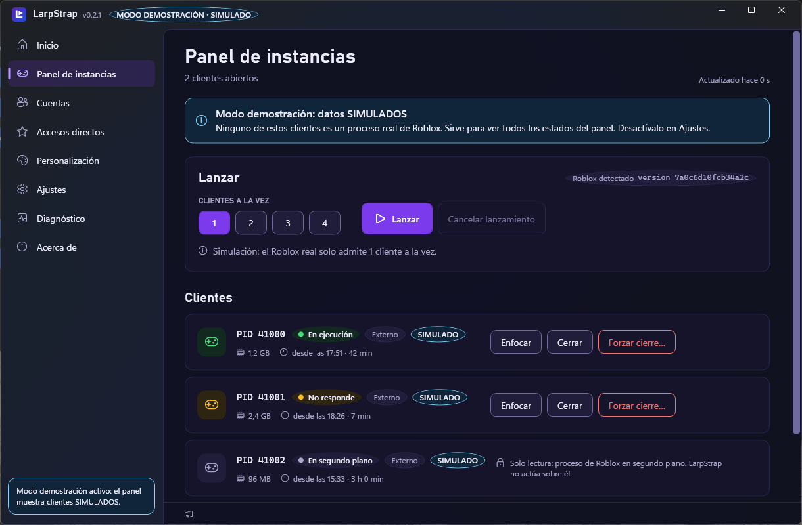

# LarpStrap

Bootstrapper de Roblox para Windows con **Clientes abiertos**, accesos a Roblox - Windows y Roblox web, gestión de FastFlags permitidos y personalización visual.

> **Estado: versión preliminar.** Las versiones se publican en [Releases](https://github.com/Kaiz-2/LarpStrap/releases), con instalador y zip portable; la instalada se actualiza sola. Lo que funciona y lo que no está en [Estado](#estado) y en [limitaciones conocidas](docs/KNOWN-LIMITATIONS.md). No está afiliado a Roblox Corporation.





## Qué hace (y qué no)

- **Clientes abiertos** (antes «Panel de instancias»): detecta los clientes de Roblox abiertos y muestra su estado («En ejecución», «No responde», «En segundo plano», etc.) y desde cuándo están abiertos. El PID y la memoria están en «Detalles».
- **Modo simple y modo avanzado:** el simple muestra Inicio, Clientes abiertos, Accesos directos y Dos cuentas. El avanzado añade FastFlags, Diagnóstico, detalles técnicos y opciones técnicas de Ajustes. La elección y la navegación contraída se recuerdan.
  - **Acciones:** enfocar, cerrar, o forzar el cierre (con confirmación).
  - **Lanzar** abre la app de Roblox. Si ya hay un cliente abierto, ofrece «Cerrar y lanzar».
- **Dos cuentas:** abre Roblox - Windows desde Microsoft Store y Roblox en el navegador para iniciar sesión por separado. Roblox puede cerrar una sesión al abrir la otra; LarpStrap no fuerza dos copias del mismo cliente (ADR 0003).
- **FastFlags:** editor de la lista permitida por Roblox, con búsqueda, filtro de cambios y validación. Se aplican al lanzar desde LarpStrap.
- **Personalización:** temas claro/oscuro/sistema, siete colores de acento, tres marcas de logotipo, material de ventana y escala de texto.
- **Sin credenciales.** LarpStrap no guarda cookies ni contraseñas, no lee la línea de comandos de Roblox (lleva tu ticket de sesión) y no registra URIs (ADR 0004). Las sesiones quedan en la app oficial y el navegador.
- **No modifica Roblox:** no inyecta código ni parchea ni toca su ejecutable.
- **Modo demostración** (Ajustes): muestra clientes **SIMULADOS**, etiquetados como tales, para ver todos los estados sin tener Roblox abierto.

## Requisitos

- Windows 10 u 11 de 64 bits, sin permisos de administrador. **No lo ejecutes como administrador.**
- Roblox Player instalado. LarpStrap usa la versión más reciente que encuentre en `%LOCALAPPDATA%\Roblox\Versions`, `…\Bloxstrap\Versions` o `…\Fishstrap\Versions`.
- [.NET 10 Desktop Runtime (x64)](https://dotnet.microsoft.com/download/dotnet/10.0) para ejecutar el paquete (ADR 0007).
- Para compilar: [.NET SDK 10.0.401](https://dotnet.microsoft.com/download) (fijado en `global.json`).

## Instalar

Desde 0.3.0: descarga `LarpStrap-Setup-<versión>-win-x64.exe`, comprueba su SHA-256 y ábrelo sin «Ejecutar como administrador». Se instala para tu usuario, sin permisos de administrador, y se desinstala desde Configuración › Aplicaciones. Sigue habiendo un zip portable con los mismos archivos. Los pasos completos, cómo actualizar y desinstalar y qué hacer si algo falla están en [docs/INSTALLATION.md](docs/INSTALLATION.md). No hay firma de código (ADR 0006): SmartScreen avisará la primera vez.

## Compilar y ejecutar desde el código

```bash
dotnet run --project src/LarpStrap.App -c Release
```

El ejecutable queda en `src/LarpStrap.App/bin/Release/net10.0-windows/LarpStrap.exe`. Los cambios de cada versión están en [CHANGELOG.md](CHANGELOG.md).

## Tus datos

| Qué | Dónde |
|---|---|
| Configuración (tema, tiempos, accesos directos) | `%LOCALAPPDATA%\LarpStrap\Settings.json`. Si se corrompe, se guarda una copia `.bad` y se usan los valores por defecto |
| Logs | `%LOCALAPPDATA%\LarpStrap\Logs`: como máximo 10 archivos de 5 MB |

Los logs solo contienen campos de una lista cerrada: versiones, PID, resultados y duraciones. Nunca guardan URIs, tickets ni rutas, y de los errores solo se registra el tipo. Desde **Diagnóstico** puedes verlos y exportarlos en un zip, que solo incluye los logs de LarpStrap, nunca los de Roblox. LarpStrap no envía telemetría. Solo se conecta a las API públicas de Roblox para mostrar el nombre y el icono de los juegos que guardas: envía el place ID, nunca datos de tu cuenta. Para actualizarse, consulta las releases de `Kaiz-2/LarpStrap` en GitHub (`api.github.com` y las descargas de GitHub) al iniciarse; no envía datos tuyos. El detalle de cada evento está en [docs/quality/observability.md](docs/quality/observability.md).

## Estado

| Función | Estado |
|---|---|
| Clientes abiertos: detectar, lanzar, enfocar y cerrar | Funciona. Verificado con un cliente real desde la interfaz del paquete 0.2.0 (2026-10-14) |
| Abrir Roblox - Windows y Roblox web | Integrado. Que ambas sesiones sigan abiertas depende de Roblox y no se ha verificado en este equipo |
| Unirse a una partida desde el navegador (`roblox-player:`) | Pendiente (P4) |
| FastFlags de la lista permitida | Integrado; la aplicación real por Roblox no se ha verificado |
| Discord Rich Presence | Pendiente |
| Actualizaciones | Automáticas al iniciar en la versión instalada: firma verificada, nunca con Roblox abierto (ADR 0009). El zip se actualiza a mano |

El plan completo y las tareas abiertas están en [PLAN.md](PLAN.md). La última auditoría, con los defectos conocidos, está en [docs/quality/final-audit.md](docs/quality/final-audit.md).

## Desarrollo

```bash
dotnet build LarpStrap.slnx -c Release                 # TreatWarningsAsErrors: 0 warnings
dotnet test --solution LarpStrap.slnx -c Release       # todos los tests
dotnet format LarpStrap.slnx --verify-no-changes       # formato, igual que en la CI
.\eng\Publish-Release.ps1                              # paquete de release (exige un commit limpio)
```

El proceso de release está en [docs/RELEASE-CHECKLIST.md](docs/RELEASE-CHECKLIST.md).

- **Estructura:**
  - `src/LarpStrap.Core`: lógica, sin interfaz;
  - `src/LarpStrap.App`: WPF con MVVM;
  - `tests/`: xUnit v3 sobre Microsoft Testing Platform.
- **Pruebas con clientes:**
  - Los tests normales usan procesos **simulados**.
  - Los de cliente real son de solo lectura y se activan con `LARPSTRAP_REAL_CLIENT=1`.
  - Toda prueba se etiqueta como simulada o de cliente real.
- **Dependencias:** se fijan con `packages.lock.json`, y la CI restaura en modo bloqueado.
- **Decisiones de arquitectura:** [docs/adr/](docs/adr/).
- **Reglas para contribuir y para agentes:** [CLAUDE.md](CLAUDE.md).
- Las comprobaciones de seguridad manuales están en `tests/manual/`.

## Licencia

[MIT](LICENSE) © 2026 Leir. Roblox es una marca de Roblox Corporation; este proyecto no está afiliado a ella ni cuenta con su aprobación.
